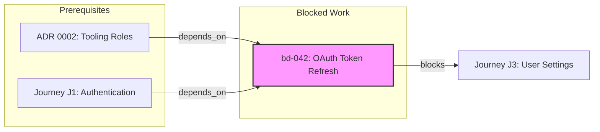

# Routing Pipeline & Sweep Specification

> **Draft input to 2.0, not part of 1.0.** This was written before the 2.0 plan
> and is kept as a source for it, not as a specification to implement. Its beads
> commands and schema do not match the real `bd` (1.3.1). What 2.0 takes from it
> is recorded in [`ROADMAP.md`](../../ROADMAP.md#release-20--bring-your-own-issue-tracker-beads-by-default).

This document formalizes the lifecycle, taxonomy, routing rules, **granularity matrix**, **dependency graphs**, **trigger evaluation engine**, and sweep procedure for all TODOs, findings, raw ideas, and work items within the framework.

It integrates a **Git-backed local issue store** (the `beads` / `.beads/` model) to maintain issue state without breaking the **cold-start constraint** of LLM coding assistants or creating external service dependencies.

---

## 1. Core Principles

1. **Zero Context Loss:** Context not committed to the repository does not exist.
2. **Single Definitive Home:** Every item lives in exactly one place appropriate to its scale and context.
3. **Git-Backed Machine Readability:** Issue state is stored in Git (`.beads/issues.jsonl`). An agent or human reads and writes issues using local CLI tasks (`bd`).
4. **Separation of Spec and State:** Rich human/LLM specifications (Journeys, ADRs) live in Markdown source documents. Issue Tracker entries store references and manage execution state.
5. **Explicit Dependencies & Triggers:** No item floats in isolation. If work relies on an ADR, journey, or prior issue, it MUST declare a dependency. If an item is deferred, it MUST specify an explicit, checkable trigger.
6. **The Deletion is the Receipt:** Routing an item means removing it from its intake source. An un-cleared intake entry is an un-routed item.

---

## 2. Granularity Matrix: Source of Truth vs. Issue Tracker

Not every item should be stored entirely in an issue tracker, nor should rich specifications be crammed into issue descriptions. The framework splits responsibility based on **Granularity**:

| Granularity Level | Examples | Source of Truth | Issue Tracker Role (`beads`) |
| :--- | :--- | :--- | :--- |
| **Macro / Structural** | Journey Specs, ADRs, Architecture Decisions | Markdown Files (`docs/journeys/J#.md`, `docs/adr/000X-*.md`) | **Tracking Index:** Holds `bd-J#` with pointer `context_ref`, status (`draft` $\to$ `red-e2e` $\to$ `shipped`), `depends_on`, and `triggers`. |
| **Micro / Atomic** | Bugs, refactoring tasks, discrete edge cases, skipped findings | Issue Tracker (`.beads/issues.jsonl`) | **Full Source of Truth:** Stored entirely in `.beads/` as child issues (`parent: bd-J#`). State transitions (`ready` $\to$ `in-progress` $\to$ `resolved`) are atomic CLI operations. |

---

## 3. Dependencies & Triggers Subsystem

### 3.1 Dependencies Subsystem

Dependencies prevent work from starting out of order. An issue can depend on another issue (`bd-XXX`), a Journey (`J#`), or an ADR (`ADR-XXXX`).

#### Dependency Fields in `.beads/issues.jsonl`:
* **`depends_on`**: Array of target identifiers that must be resolved/completed before this item is actionable.
* **`parent`**: Optional parent issue ID (e.g. `bd-J01` for child tasks under Journey 1).
* **`blocks`**: (Derived/Computed) Array of items that depend on this issue.

#### Dependency Resolution States:
* **`blocked`**: At least one item in `depends_on` is still unresolved.
* **`ready`**: All items in `depends_on` are resolved AND any associated trigger has fired.



---

### 3.2 Triggers Subsystem

Triggers define the exact condition under which a deferred item, sketch, or process experiment becomes actionable.

#### Trigger Structure in Schema:
```json
"trigger": {
  "type": "journey_complete | issue_resolved | metric_threshold | event",
  "condition": "J2 shipped",
  "status": "waiting",
  "evaluated_at": "2026-08-07T17:00:00Z"
}
```

#### Trigger Types:
1. **`journey_complete`**: Re-evaluates when a specific journey lands (e.g. `"J2 shipped"`).
2. **`issue_resolved`**: Re-evaluates when a specific prerequisite issue is closed.
3. **`metric_threshold`**: Re-evaluates when an empirical metric crosses a threshold (e.g. `"table_rows > 50,000"` or `"test_suite_time > 10s"`).
4. **`event`**: External event or stakeholder milestone (e.g. `"design_system_v2_delivered"`).

---

## 4. Item Scale & Context Taxonomy

Every item discovered or proposed is classified by **Scale** and **Context**:

| Type | Scale | Description | Primary Home / Target |
| :--- | :--- | :--- | :--- |
| **`micro-task`** | Session / Journey | Discrete sub-task required to make the current journey's E2E test pass | Issue Tracker (`.beads/issues.jsonl`, `parent: bd-J#`) $\to$ Closed when green |
| **`sketch`** | Release / Macro | High-level idea for a future journey or capability | Beads issue (`type: sketch`) $\to$ Promoted to `docs/journeys/J#.md` at release boundary |
| **`deferred`** | Micro to Macro | Technical debt or skipped optimization found during journey execution | Beads issue (`type: deferred`, requires `trigger` and optional `depends_on`) |
| **`adr-candidate`** | Architectural | High-impact, expensive-to-reverse structural move | Draft ADR in `docs/adr/` |
| **`design-note`** | Framework / Code | Generalizable engineering rule, refusal guard, or safety pattern | `docs/design-notes.md` |
| **`process-experiment`** | Meta-Process | Workflow friction, missing categorization, or procedure flaw | `docs/experiments.md` or `CLAUDE.md` |
| **`raw-intake`** | Unclassified | Unprocessed note, `Lesson:` commit trailer, or spontaneous thought | `docs/inbox/` (Temporary holding) |

---

## 5. Re-architected Handoff & The Journey Microloop

### 5.1 Resolving Semantic Confusion in the Microloop
Managing individual task TODO lists inside prose Markdown handoff files previously caused semantic drift and vague `TODO` $\to$ `DONE` transitions.

Under this specification, responsibilities are cleanly separated:

1. **Active Task Execution:** Handled deterministically by `.beads/` child issues. Micro-tasks are moved between states (`ready` $\to$ `in-progress` $\to$ `resolved`) using exact CLI calls verified by failing/passing tests.
2. **The Handoff Document (`docs/handoff/J#.md`):** Functions as the **Implementation Spec, Context Bridge & Residue Register**:
   * **Context Bridge:** Links the Journey document (`docs/journeys/J#.md`), names the active E2E test, and records cold session state.
   * **Residue Register:** Captures unexpected insights, unrouted knowledge, or edge-case notes that surface during implementation.

### 5.2 The Residue Test & Process Feedback Loop
When all child issue tasks for a journey reach `resolved` in
`.beads/`:

1. The developer/agent scans the remaining notes in `docs/handoff/J#.md`.
2. Each residual note is routed (to an ADR, a `design-note`, or a `deferred` beads issue with a trigger).
3. **The Feedback Loop:** If an item cannot be routed into existing categories, it MUST be treated as a **Process Finding**. Log it in `docs/experiments.md` or `CLAUDE.md` to improve the framework's routing rules before deleting the handoff file.

---

## 6. Git-Backed Issue Schema (`beads` format)

Issues are stored locally in `.beads/issues.jsonl` (one JSON object per line).

```json
{
  "id": "bd-042",
  "parent": "bd-J04",
  "title": "Query optimizer drops index hint on JOIN",
  "type": "deferred",
  "scale": "macro",
  "status": "open",
  "found_in": "J4",
  "depends_on": ["J4", "bd-012"],
  "trigger": {
    "type": "metric_threshold",
    "condition": "Table size exceeds 50,000 rows or query latency > 100ms",
    "status": "waiting",
    "evaluated_at": "2026-08-07T17:00:00Z"
  },
  "context_ref": "docs/journeys/J4-search-query.md",
  "tags": ["performance", "database"],
  "created_at": "2026-08-07T17:00:00Z",
  "updated_at": "2026-08-07T17:00:00Z"
}
```

---

## 7. The Sweep & Trigger Evaluation Specification (`task sweep`)

The `sweep` task is an explicit procedure executed by an LLM agent or human developer to process unrouted intake AND evaluate active triggers/dependencies.

```text
1. EVALUATE EXISTING TRIGGERS & DEPENDENCIES:
   a. Load all issues from .beads/issues.jsonl with status "waiting".
   b. For each item with `depends_on`:
      - Check if all prerequisite IDs (issues, journeys, ADRs) are in status "resolved"/"shipped".
   c. For each item with `trigger`:
      - Evaluate `trigger.condition` against recent git logs, shipped journeys, or reported metrics.
      - If condition is met, set `trigger.status = "triggered"`.
   d. IF (all `depends_on` resolved AND trigger is triggered/empty):
      - Update issue `status = "ready"`.

2. EXTRACT NEW INTAKE ITEMS:
   a. Scan docs/inbox/ for non-empty entries.
   b. Run `git log --grep="Lesson:" --since=<last_sweep_tag>` to extract inline trailers.
   c. Scan current docs/handoff/ for leftover residual notes after journey execution.
   d. Read `.beads/issues.jsonl` for entries with `status: "raw"`.

3. ROUTE NEW INTAKE ITEMS:
   a. Identify item Scale, Dependencies, and Trigger from Taxonomy.
   b. Write item to its target home:
      - If `sketch` or `deferred`: append/update in `.beads/issues.jsonl`.
      - If `adr-candidate`: create `docs/adr/000X-<name>.md` draft.
      - If `design-note`: append to `docs/design-notes.md`.
      - If `process-experiment`: append to `docs/experiments.md`.
   c. REMOVE item from source intake file/trailers (Delete line / clear inbox entry).

4. VERIFY RESIDUE:
   - Verify zero un-routed items remain in docs/inbox/.
   - Verify handoff file is empty of un-routed residual notes (and remove handoff file).

5. COMMIT:
   - Execute: git commit -m "docs(sweep): triaged intake items & updated trigger/dependency states"
```

---

## 8. CLI Tasks for Full Visibility

| Task | Action | Description / Output |
| :--- | :--- | :--- |
| **`task sweep`** | Run sweep & trigger check | Triages intake, evaluates triggers, updates `waiting` $\to$ `ready` |
| **`bd list --ready`** | View actionable work | Shows all items where `depends_on` is clear and triggers have fired |
| **`bd list --blocked`** | View blocked work | Shows items waiting on unresolved dependencies or un-fired triggers |
| **`bd list --triggers`** | View active triggers | Shows all items in `waiting` state with their trigger conditions |
| **`bd tree`** | Dependency DAG | Renders an ASCII dependency tree showing what blocks what |
| **`bd add "<title>"`** | Create raw issue | Appends a new item to `.beads/issues.jsonl` |
